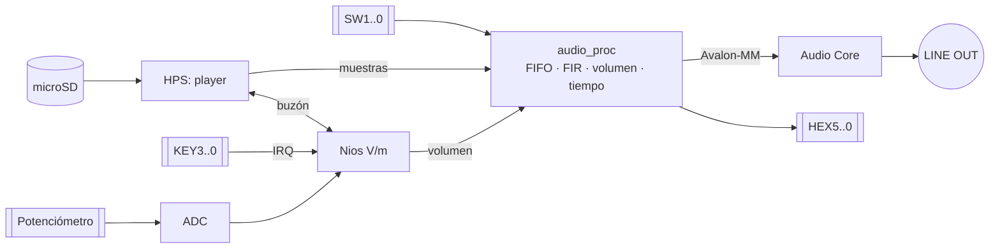
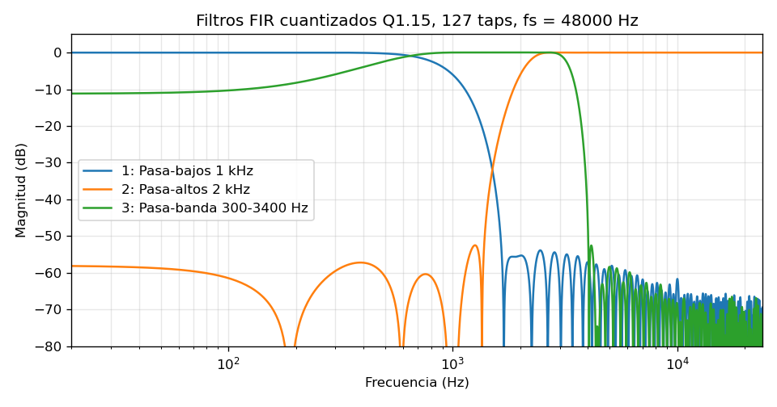

# Co-diseño Hardware/Software de SoC con Hardware Personalizado para Reproductor de Audio Avanzado

Proyecto II de CE-1113 Sistemas Empotrados, Instituto Tecnológico de Costa Rica. Reproductor de audio sobre la DE1-SoC: el HPS (ARM Cortex-A9 con Linux mínimo) lee canciones WAV de la microSD y envía las muestras a un módulo de hardware propio en la FPGA (`audio_proc`), que aplica filtros FIR y volumen, lleva el tiempo de reproducción en los displays de 7 segmentos y escribe en el Audio Core del codec WM8731. Un Nios V/m en bare metal atiende los botones por interrupción, el volumen y la pantalla.

**Equipo:** Yerik, Emmanuel, Gabriel y Sergio · **Flujo de trabajo:** [CONTRIBUTING.md](CONTRIBUTING.md) · **Planificación:** [BACKLOG.md](BACKLOG.md)

## Arquitectura

Partición hardware/software y justificación: [docs/arquitectura.md](docs/arquitectura.md). Registros y secuencias de uso: [docs/mapa-registros.md](docs/mapa-registros.md). Software, máquina de estados y buzón: [docs/diseno-software.md](docs/diseno-software.md).



## Estructura del repositorio

| Ruta | Contenido |
|---|---|
| `fpga/ip/audio_proc/` | RTL del módulo personalizado y su componente de Platform Designer (`audio_proc_hw.tcl`) |
| `fpga/sim/audio_proc/` | Testbench autoverificable, vectores y scripts de simulación |
| `fpga/scripts/` | Generación del sistema de Platform Designer por Tcl y compilación |
| `fpga/quartus/` | Proyecto de Quartus: top-level, pines y restricciones de tiempo |
| `sw/src`, `sw/tests` | Software del HPS en C y pruebas unitarias |
| `sw/niosv/` | Aplicaciones bare metal del Nios V/m |
| `tools/` | Diseño de filtros, modelo de referencia y preparación de canciones |
| `docs/` | Diseño, mapa de registros, evidencias de verificación |

## Verificación del módulo `audio_proc`

```bash
cd fpga/sim/audio_proc && ./run_iverilog.sh
```

Resultados y casos: [docs/verificacion/audio_proc.md](docs/verificacion/audio_proc.md).



## Software del HPS

```bash
cd sw && make test      # pruebas en PC
cd sw && make arm       # binario estático del HPS: sw/build-arm/reproductor
```

Canciones para la SD (WAV PCM 16 bits con metadatos LIST/INFO):

```bash
python3 tools/gen_test_wavs.py sd_prueba            # 12 pistas sintéticas a 8, 16 y 44,1 kHz
tools/prepare_music.sh musica/ sd_final 44100       # conversión de canciones propias con ffmpeg
```

## Compilar y programar la FPGA

Requiere Quartus Prime Lite 25.1std y los IP de [fpgacademy/IP_Cores](https://github.com/fpgacademy/IP_Cores) copiados en `<instalación>/ip/`.

```bash
source ~/taller09/scripts/env.sh          # PATH de Quartus, Questa y Nios V
fpga/scripts/build_fpga.sh todo           # genera el sistema, compila y programa
sw/niosv/build.sh bringup descargar       # compila, descarga y abre la consola del Nios V
```

## Ejecutar en la placa

Imagen de la microSD: Linux Console de Terasic para la DE1-SoC (`DE1_SoC_SD.img`, kernel 3.12). El programa y las canciones van en `/home/root`, dentro de la partición ext3.

```bash
# PC con Linux, con la microSD en /dev/sdX
unzip -p DE1_SoC_SD.zip DE1_SoC_SD.img | sudo dd of=/dev/sdX bs=4M conv=fsync status=progress
sudo mount /dev/sdX2 /mnt
sudo mkdir -p /mnt/home/root/musica
sudo cp sd_prueba/*.wav /mnt/home/root/musica/ && sudo cp sw/build-arm/reproductor /mnt/home/root/
sudo umount /mnt
```

Consola serie por el puerto UART to USB a 115200 baudios, usuario `root`. El orden importa porque programar la FPGA reinicia el buzón:

```bash
fpga/scripts/build_fpga.sh programar                     # PC: FPGA por JTAG
echo 1 > /sys/class/fpga-bridge/lwhps2fpga/enable         # placa: habilita el puente HPS-FPGA liviano
cd /home/root && ./reproductor -d /home/root/musica      # placa: -f para volumen fijo
sw/niosv/build.sh control descargar                      # PC: control del Nios V
```

Botones: KEY3 anterior, KEY2 stop, KEY1 reproducir/pausa, KEY0 siguiente. SW1..SW0 seleccionan el filtro y el potenciómetro en ADC_IN0 controla el volumen.
