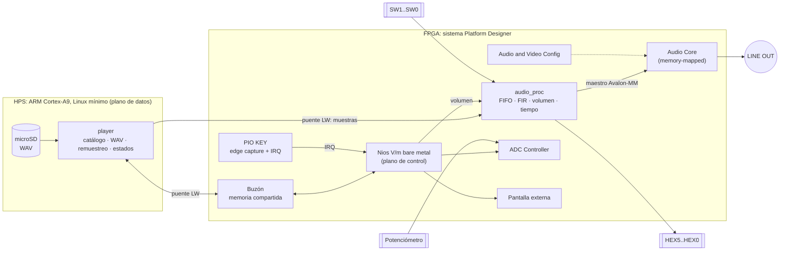

# Arquitectura y partición hardware/software

**Issue:** ARC-01 · **Estado:** propuesta para aprobación del equipo.

## Diagrama de bloques

## Partición

| Función | Dónde | Motivo |
|---|---|---|
| SD y sistema de archivos | HPS (Linux) | Obligatorio. Linux monta la SD y evita escribir un controlador. |
| Parseo WAV, metadatos y catálogo | HPS | Formato de longitud variable sin requisito de tiempo real; código probado en PC. |
| Conversión 8/16/44,1 kHz → 48 kHz | HPS | El codec opera a una frecuencia fija: el WM8731 no ofrece 16 kHz y 44,1 kHz requiere otro MCLK. Con una sola frecuencia en FPGA basta un juego de coeficientes por filtro, el tiempo tiene una base fija y el cambio de pista no reconfigura el codec. |
| Envío de muestras a `audio_proc` | HPS | El HPS ya tiene el archivo abierto; una escritura de 32 bits por muestra estéreo por el puente LW. |
| Botones | PIO con IRQ + ISR en Nios V | Obligatorio por interrupciones. En bare metal la ISR se registra con `alt_ic_isr_register`, la única función HAL permitida, sin depender del kernel de la imagen Linux. |
| Volumen | Nios V lee el ADC; multiplicador en `audio_proc` | El escalamiento y la saturación quedan en el mismo datapath del filtro. |
| Pantalla externa | Nios V | Recibe los metadatos por el buzón y no compite con el envío de muestras del HPS. |
| FIFO de muestras | `audio_proc` | 4096 muestras = 85 ms a 48 kHz; absorbe la variación de planificación de Linux. |
| Tres filtros FIR | `audio_proc` | Al menos uno debe ser HDL propio; un motor MAC secuencial con tres bancos de coeficientes implementa los tres con 2 multiplicadores. |
| Selección de filtro | `audio_proc` lee SW1..SW0 | El cambio aplica en la siguiente muestra. |
| Tiempo MM:SS en 7 segmentos | `audio_proc` | Obligatorio. Cuenta las muestras escritas en el Audio Core: la pausa congela el tiempo sin intervención del software. |
| Salida al codec | Maestro Avalon-MM en `audio_proc` | El Audio Core se usa en modo memory-mapped, la configuración que FPGAcademy usa en sus sistemas para la DE1-SoC; el módulo lee `FIFOSPACE` y escribe izquierda/derecha. |

## Decisión sobre Nios V

Se usa un Nios V/m como plano de control en bare metal. Motivos:

1. El enunciado pide demostrar programación **Bare Metal**; el HPS corre Linux.
2. Atender los botones por interrupción desde Linux requiere un controlador de kernel o UIO, que dependen de la imagen de la SD. En el Nios V la ISR se registra con HAL según la excepción que autorizó el profesor.
3. El flujo Nios V/m con Quartus 25.1, `niosv-bsp`/`niosv-app` y Questa ya está validado en el Taller 09.

## Etapas de integración

| Etapa | Contenido | Prueba en la placa |
|---|---|---|
| 1 | Nios V/m, `audio_proc`, Audio Core, configuración del codec, PIO de botones, ADC | Programa `bringup`: tono por LINE OUT, filtros con switches, IRQ de botones, volumen con potenciómetro, tiempo en HEX |
| 2 | HPS con puente LW y buzón | HPS lee `ID` de `audio_proc` y reproduce un WAV de la SD |
| 3 | Pantalla externa | Metadatos, pista N/total, estado y filtro |

## Alternativas para el filtro DSP

| Alternativa | Recursos | Latencia de cambio | Decisión |
|---|---|---|---|
| FIR en software (ARM) | 0 bloques DSP; ~12 M MAC/s de CPU para 127 taps estéreo | Hasta 85 ms: las muestras en la FIFO ya están filtradas | No: el enunciado exige al menos uno en HDL. |
| FIR paralelo en HDL | ≥ 127 multiplicadores por canal; el 5CSEMA5 tiene 87 bloques DSP | 1 ciclo | No: no cabe y a 48 kHz no hace falta. |
| FIR secuencial en HDL | 2 multiplicadores, RAM en M10K | 1 muestra (21 µs) | **Sí.** |
| IP FIR Compiler | — | — | No permitido por el enunciado. |

## Presupuesto inicial

| Recurso | Uso | Motivo |
|---|---|---|
| Memoria del Nios V | 256 KB en M10K | Programa con HAL; el Taller 09 midió 95 KB para un programa mínimo con `printf`. |
| FIFO de `audio_proc` | 4096 × 32 bits | 85 ms de margen frente a la planificación de Linux. |
| Ciclos por muestra en `audio_proc` | ~135 de 1041 disponibles (50 MHz / 48 kHz) | El motor MAC usa el 13 % del tiempo. |
