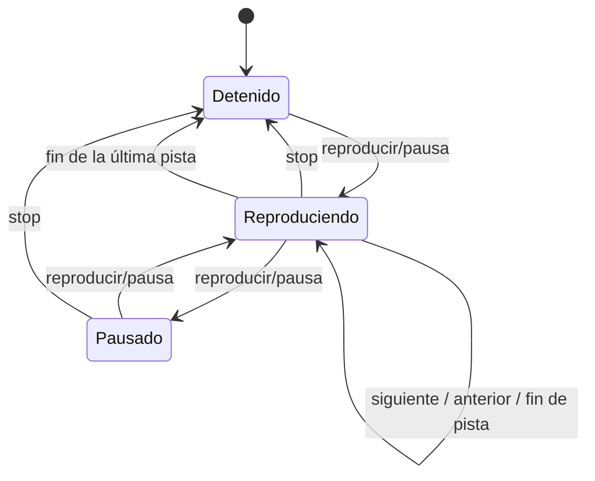

# Diseño de software

**Issue:** DOC-01 (base) · Contrato de hardware: [mapa-registros.md](mapa-registros.md) · Arquitectura: [arquitectura.md](arquitectura.md)

## Programas

| Programa | Procesador | Fuente | Función |
|---|---|---|---|
| `reproductor` | HPS, Linux, binario estático | `sw/src/main_hps.c` | Catálogo de la SD, máquina de estados, lectura de WAV, conversión a 48 kHz y envío de muestras a `audio_proc` |
| `control` | Nios V/m, bare metal | `sw/niosv/control/main.c` | ISR de botones, comandos al HPS, volumen desde el ADC, interfaz y medición de latencia |
| `bringup` | Nios V/m, bare metal | `sw/niosv/bringup/main.c` | Prueba de la etapa 1 sin HPS |

## Módulos del HPS

| Módulo | Responsabilidad | Pruebas |
|---|---|---|
| `wav` | Valida RIFF/WAVE PCM de 16 bits (1–2 canales, 8–48 kHz) y extrae `INAM`, `IART`, `IPRD` | 19 verificaciones: formatos válidos, inválidos, truncados, metadatos antes y después de `data` |
| `catalog` | Lista ordenada por nombre de archivo, omite ocultos y rechaza WAV inválidos sin detenerse; valores por defecto sin metadatos | 11 verificaciones |
| `resampler` | Interpolación lineal con posición Q32.32 hacia 48 kHz, por bloques | 9 verificaciones: identidad, monotonía, 44,1 kHz, equivalencia por bloques, mono |
| `mailbox` | Cola de comandos y estado con contador de secuencia | 5 verificaciones: cola llena, orden, lectura consistente |
| `player` | Máquina de estados y alimentación de la FIFO a través de `audio_out_t` | 21 verificaciones con `audio_proc` simulado: lista completa bit-exacta, pausa, siguiente, stop, navegación circular |

`player` no accede al hardware directamente: recibe una interfaz `audio_out_t` (espacio en la FIFO, FIFO vacía, escribir, `CTRL`, `TRACK`). En la placa la implementa `main_hps.c` con punteros a la ventana del puente LW obtenida con `mmap` de `/dev/mem`; en las pruebas, un modelo que consume 48 muestras por milisegundo.

## Máquina de estados (PLAY-01)

| Evento | Efecto | Motivo |
|---|---|---|
| Pausa | `RUN = 0`; la FIFO conserva las muestras | Reanuda sin perder audio y el tiempo en HEX se congela solo |
| Stop | `FLUSH`, `TIME_CLR`; queda en la misma pista | Tiempo en 00:00 y siguiente play desde el inicio |
| Siguiente / anterior | Circulares; si reproducía, la nueva pista suena; si no, queda detenido en ella | Navegación sin bordes muertos |
| Fin de pista | Espera la FIFO vacía, luego `FLUSH`, `TIME_CLR`, `TRACK` y precarga de la siguiente | El tiempo y la pista cambian cuando realmente cambia el audio; en la simulación el silencio entre pistas es de 0,2 ms |
| Fin de la lista | Detenido en la primera pista | Comportamiento definido (AUD-04) |

## Buzón HPS ↔ Nios V

Memoria de 4 KB en la FPGA (`0xFF210000`), accedida por ambos procesadores con punteros `volatile`.

| Campo | Escribe | Uso |
|---|---|---|
| `magic` | HPS | `MBX1` cuando el reproductor está listo |
| `heartbeat` | HPS | Se incrementa cada 2 ms; el Nios V detecta un HPS detenido |
| `flags` | HPS | `MBX_FLAG_FIXED_VOL` (opción `-f`): volumen fijo mientras no hay potenciómetro |
| `cmd_head`, `cmd[16]` | Nios V | Cola de comandos: un solo productor |
| `cmd_tail` | HPS | Comandos consumidos: un solo consumidor |
| `seq`, estado | HPS | Impar mientras se escribe; el Nios V descarta lecturas con `seq` impar o cambiado |

Cada lado escribe solo sus campos, así que no se necesitan bloqueos entre procesadores.

## Botones

| Botón | Comando |
|---|---|
| KEY3 | Anterior |
| KEY2 | Stop |
| KEY1 | Reproducir / pausa |
| KEY0 | Siguiente |

La ISR del Nios V lee y limpia el registro de edge capture del PIO, cuenta el evento y guarda `mtime`. El lazo principal envía el comando y, cuando el HPS lo consume, imprime la latencia (CTL-02). Los botones de la DE1-SoC tienen antirrebote por Schmitt trigger en la placa.

## Restricciones del profesor

- HAL solo para interrupciones: `alt_ic_isr_register` en el Nios V; ningún otro `alt_*`.
- Acceso a periféricos con punteros a las bases de `system.h`, sin `IOWR`/`IORD`.
