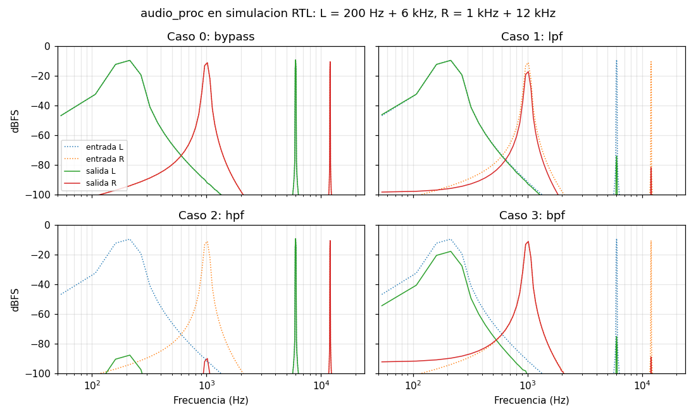

# Verificación aislada de `audio_proc`

**Issue:** FPGA-04 · **Fecha de la corrida:** 2026-11-26 (antes de integrar el módulo al sistema).

## Método

El testbench [`fpga/sim/audio_proc/tb_audio_proc.v`](../../fpga/sim/audio_proc/tb_audio_proc.v) usa el módulo solo a través de sus registros Avalon-MM, como lo hará el software del HPS, y modela el Audio Core en modo memory-mapped: registros `FIFOSPACE`, `LEFTDATA` y `RIGHTDATA`, FIFOs de 128 muestras que el codec vacía cada 300 ciclos y `waitrequest` pseudoaleatorio. Cada muestra escrita se compara muestra por muestra contra el modelo bit-exacto de [`tools/gen_vectors.py`](../../tools/gen_vectors.py), que reproduce la aritmética del RTL (productos Q1.15, acumulador de 40 bits, redondeo y saturación a 16 bits).

Parámetros de simulación: `FIFO_AW = 6` (64 muestras) para ejercitar FIFO llena y contrapresión; `FS_HZ = 8` para que 1024 muestras equivalgan a 2:08 y se prueben los acarreos de segundos y minutos.

## Casos

| # | Caso | Qué verifica |
|---|---|---|
| — | Registros tras reset | `ID`, `FIFO_DEPTH`, `CTRL`, `VOLUME`, `FIFO_SPACE` |
| — | FIFO llena | `FIFO_SPACE = 0`, `STATUS`, `OVERFLOW = 6` con 70 escrituras, `FLUSH` |
| — | 7 segmentos | Pista 7, 42 y 0 en HEX5..HEX4; `HEX_EN = 0` apaga los seis displays |
| — | Switches | `STATUS` refleja SW1..SW0 y la selección por registro |
| 0 | Bypass, volumen 1,0 | Salida idéntica a la entrada |
| 1–3 | Pasa-bajos, pasa-altos, pasa-banda | Salida bit-exacta contra el modelo |
| 4 | Pasa-bajos, volumen 0,5 | Escalamiento de volumen |
| 5 | Bypass, volumen ≈ 2,0, onda cuadrada a escala completa | Saturación (1526 muestras saturadas) |
| 6 | Pasa-bajos con onda cuadrada e impulsos a escala completa | Saturación por sobreoscilación del filtro |
| 7 | Pasa-altos elegido por switches | Selección en hardware |
| 8 | Banco 3 reprogramado por `COEF_ADDR`/`COEF_DATA` | Control de coeficientes desde software |

En cada caso además: pausa con `RUN = 0` sin salida y con `FIFO_SPACE` conservado, `PLAYED`, `TIME` en BCD, HEX3..HEX0, `UNDERRUN` y `STATUS`. Un monitor verifica el protocolo del maestro Avalon-MM: señales estables durante `waitrequest`, izquierda antes que derecha, `[15:0]` en cero y sin escribir con las FIFOs del Audio Core llenas. Se exige además que las FIFOs del modelo se llenen en algún momento, para ejercitar la contrapresión.

## Resultado

90 verificaciones, 0 fallas, 0 errores de protocolo. Las 9 × 1024 muestras coinciden bit a bit. Registro: [`audio_proc_iverilog.log`](audio_proc_iverilog.log).

Como control del propio testbench, eliminar el término de redondeo del acumulador produce diferencias en 8 de los 9 casos y `RESULTADO: FAIL`.



## Reproducir

```bash
cd fpga/sim/audio_proc
./run_iverilog.sh                 # Icarus Verilog
vsim -c -do run_questa.do         # Questa / ModelSim
python3 ../../../tools/check_sim.py
```

Los vectores se regeneran con `python3 tools/filters.py && python3 tools/gen_vectors.py`.
